# Java delivery pipeline: Jenkins → Container Registry → Kubernetes

[Русский](README.ru.md) | **English**

A Java 17 / Spring Boot service that is built, published as an immutable image and
deployed to Yandex Managed Kubernetes by a Jenkins pipeline and Helmfile. The subject
of the repository is the delivery path, not the application: four Jenkins stages,
three Helm releases, four rollout gates and an HTTP smoke test.

`Java 17` · `Spring Boot 3.5.5` · `Gradle 8.12` · `MySQL` · `Docker Compose` · `Jenkins` ·
`Yandex Container Registry` · `Managed Kubernetes` · `Helm` · `Helmfile` · `phpMyAdmin`

> **The cloud environment is decommissioned.** Jenkins builds and cluster screenshots
> cannot be reproduced, and the pipeline cannot be replayed end to end without a
> Yandex Cloud account. What describes the flow is in this repository: the
> [`Jenkinsfile`](Jenkinsfile), the [`helm/`](helm/) bundle with its own
> [README](helm/README.md), and two diagrams in [`docs/`](docs/). The application
> still runs locally with one `docker compose up`.

## Quick start (no cloud account)

```bash
cp .env.example .env        # replace the placeholder passwords
./gradlew clean build       # produces build/libs/java-gradle-app.jar
docker compose up --build
```

The Compose stack starts three containers and stores database files in the
`mysql-data` volume:

| Address | What runs there |
|---|---|
| <http://localhost:8080> | the application: static page plus `GET /get-data` |
| <http://localhost:8085> | phpMyAdmin (`PMA_HOST=mysql`) |
| `localhost:3306` | MySQL `9.7.2` |

`.env` is git-ignored and only `.env.example` with placeholders is committed. MySQL
has a healthcheck, and the application waits for it (`depends_on: condition:
service_healthy`), so the first boot creates and seeds the table instead of racing the
database. The image is built from the JAR, which is why `./gradlew build` comes first.

## What this proves

- **Immutable releases.** Images are tagged with the full commit SHA, and the
  deployment consumes the registry digest read back after the push, so a mutable tag
  cannot silently change what runs.
- **Least-privilege delivery.** Jenkins authenticates with a Yandex Cloud service
  account and a namespace-scoped `Role`/`RoleBinding` in `default`; CI holds no
  cluster-scoped permissions.
- **Gated deploys.** `helmfile apply --wait` is followed by `kubectl rollout status`
  on the application, phpMyAdmin and both MySQL StatefulSets, then by an HTTP smoke
  test that asserts the response body.
- **Local reproducibility.** The same application and database come up from one
  `docker compose up`, so the project is reviewable without a cloud account.

## Pipeline

<p align="center">
  
</p>

The [`Jenkinsfile`](Jenkinsfile) has four stages; the diagram splits them into six
steps, because two of them hold a single decision each.

| # | Stage | What happens |
|---|---|---|
| 1 | `Prepare Build` | `git rev-parse HEAD` becomes `IMAGE_TAG` — the full commit SHA |
| 2 | `Build JAR` | `./gradlew clean build`; the artifact is `build/libs/java-gradle-app.jar` |
| 3 | `Build and push Image` | `docker build --provenance=false`, `docker push` to `cr.yandex/<registry-id>/gradle-app:$IMAGE_TAG` |
| 4 | `Deploy` | temporary kubeconfig from `yc`, a check that `Secret/mysql-secret` exists, `helmfile lint`, `helmfile template`, `helmfile apply --skip-deps --wait --timeout 300`, then four `kubectl rollout status` calls and `GET /get-data` |

The digest is read inside stage 3 with
`docker inspect --format='{{index .RepoDigests 0}}' … | cut -d'@' -f2`, and the build
fails when it comes back empty. From that point the image is addressed as
`<repository>@sha256:…`, so the tag is only a human-readable label. A push therefore
produces exactly one deployable artifact, and the running pods can be traced back to a
commit without trusting a tag.

`disableConcurrentBuilds()` and a 30-minute timeout are set at the pipeline level: two
pushes must not interleave two `helmfile apply` runs against the same release names.

## Architecture

Two independent layers — the local Compose stack and the cluster release set. Dashed
components are external to this repository.

<p align="center">
  
</p>

## Application

A small service with direct MySQL JDBC access; there is no ORM and no migration tool.

- `GET /get-data` returns the team members as JSON, `[{"name": "Sarah", "role": "Full
  stack developer"}, …]` (see
  [`AppController.java`](src/main/java/com/example/AppController.java)).
- `GET /` serves the static page from
  [`src/main/resources/static/index.html`](src/main/resources/static/index.html),
  which fetches `/get-data` and renders the list.
- On startup [`Application.java`](src/main/java/com/example/Application.java) creates
  `team_members` if it is missing and inserts five rows **only when the table is
  empty**, so restarts do not duplicate data.
- Configuration comes from the environment —
  [`DatabaseConfig.java`](src/main/java/com/example/DatabaseConfig.java) reads
  `DB_USER`, `DB_PWD`, `DB_SERVER` and `DB_NAME`. Port `3306` is hardcoded, and
  `DB_SERVER` is a host name without a port.
- The service is read-only from the outside: no endpoint writes to the database. The
  seeding above is the only write in the code base.

## Repository layout

| Path | Purpose |
|---|---|
| [`Jenkinsfile`](Jenkinsfile) | the delivery pipeline, four stages |
| [`helm/helmfile.yaml.gotmpl`](helm/helmfile.yaml.gotmpl) | release list, `needs` order, `helmDefaults` |
| [`helm/myappchart`](helm/myappchart) | ConfigMap, Deployment (3 replicas), Service, Ingress |
| [`helm/phpmyadminchart`](helm/phpmyadminchart) | Deployment, Service on `8085` |
| [`helm/mysql-helm-values.yaml`](helm/mysql-helm-values.yaml) | replication, PVCs, `existingSecret` |
| [`helm/README.md`](helm/README.md) | the bundle in detail: resources, Secret contract, RBAC scope |
| [`src/`](src) | Java sources, static page, one JUnit test |
| [`docker-compose.yaml`](docker-compose.yaml) | local stack: application, MySQL, phpMyAdmin |
| [`Dockerfile`](Dockerfile) | runtime image: Temurin 17 JRE, non-root user `10001` |
| [`docs/`](docs) | animated SVG diagrams for the pipeline and the architecture |
| [`.env.example`](.env.example) | placeholder local credentials |
| [`build.gradle`](build.gradle) | Java 17 toolchain, Spring Boot plugin, `java-gradle-app.jar` |

## Kubernetes deployment

Helmfile deploys three releases into the existing `default` namespace, in the order set
by `needs`:

| Release | Chart | Version | Workloads | Notes |
|---|---|---|---|---|
| `myapp` | `./myappchart` | `0.1.0` | Deployment ×3, Service `8080`, Ingress | image is `APP_IMAGE@APP_IMAGE_DIGEST` when the digest is set, otherwise `APP_VERSION` |
| `phpmyadmin` | `./phpmyadminchart` | `0.1.0` | Deployment ×1, Service `8085` | `PMA_HOST` from the shared ConfigMap |
| `mysql` | `bitnamicharts/mysql` (OCI) | `14.0.3` | primary and secondary StatefulSets, 5Gi PVC each | `existingSecret: mysql-secret`, database `mysqldb` |

Details that decide whether a deployment succeeds:

- `APP_IMAGE`, `APP_VERSION` and `APP_IMAGE_DIGEST` are `requiredEnv` in the Helmfile:
  without all three, rendering stops with an error instead of falling back to a default
  image.
- `helmDefaults` set `createNamespace: false`, `wait: true`, `atomic: true`,
  `timeout: 300`. The namespace must already exist, Helm waits for the resources, and
  a failed install or upgrade is rolled back where Helm can do so — database schema and
  data are **not** part of that rollback.
- [`Deployment`](helm/myappchart/templates/deployment.yaml) renders
  `"<repository>@<digest>"` when `appImageDigest` is non-empty, which is what Jenkins
  always supplies. The pod runs as `10001:10001`, `runAsNonRoot` and
  `allowPrivilegeEscalation: false`, with TCP startup/readiness/liveness probes.
- `Secret/mysql-secret` is external and must exist before the first deploy. The
  required keys are `mysql-root-password`, `mysql-password` and
  `mysql-replication-password`.
- `ingress-nginx` is external cluster infrastructure; the application chart only
  creates `Ingress/myapp` with IngressClass `nginx`, so the controller has to be
  installed separately.

The two MySQL images are pinned independently: Compose runs `mysql:9.7.2` for local
review, while the chart pins `bitnamilegacy/mysql:9.4.0-debian-12-r1` with
`global.security.allowInsecureImages: true`, because the selected chart configuration
needs that repository. Before relying on a server feature, check it against the image
the cluster actually runs, not against the Compose one.

## Local validation

Both commands render the bundle without contacting a cluster, so they work with
placeholder values:

```bash
cd helm
APP_IMAGE=cr.yandex/<registry-id>/gradle-app APP_VERSION=dev APP_IMAGE_DIGEST=sha256:dev helmfile lint --skip-deps
APP_IMAGE=cr.yandex/<registry-id>/gradle-app APP_VERSION=dev APP_IMAGE_DIGEST=sha256:dev helmfile template --skip-deps
```

`helmfile apply` is the first command that needs a real cluster and a real
`mysql-secret`. The full inventory of resources, persistence settings and the exact
RBAC scope is in [`helm/README.md`](helm/README.md).

## Limitations

- **The cloud is gone.** `SMOKE_TEST_URL` is a hardcoded `http://84.252.132.38` from
  the decommissioned cluster; the registry id and cluster name (`k8s-cluster`) are
  hardcoded in the `Jenkinsfile` environment as well. A real rerun starts with
  replacing those values.
- **Digest pinning assumes a local Docker daemon.** `.RepoDigests` stays empty with
  some remote or `buildx` builders, and the pipeline then fails by design instead of
  deploying an unpinned image.
- **One test, and it does not touch the database.** [`AppTest`](src/test/java/AppTest.java)
  asserts the constant returned by `getStatus()`; the `Connection` field is never
  injected outside a Spring test context. `./gradlew build` is a compile and package
  check, not coverage.
- **The smoke test is one row.** It asserts that the response body contains `Sarah`,
  that is, that the seeded row survived the deploy. The application has no write
  endpoint, so nothing exercises the database from outside.
- **`atomic: true` does not protect data.** A rollback restores manifests, not the
  MySQL schema or its contents.
- **The first deployment needs manual prerequisites.** Namespace, Secret and
  ingress-nginx are not created by this repository.
- **phpMyAdmin has no extra authentication** beyond the MySQL credentials. Acceptable
  for a lab, not for a shared cluster.

## Requirements

- Local: Docker Engine with Compose v2, and a JDK 17 toolchain (Gradle downloads one
  through the foojay resolver if the machine has none).
- Jenkins agent: Git, Docker with a daemon able to build and push, the Gradle wrapper
  plus a JDK 17, `yc` (`/var/jenkins_home/yandex-cloud/bin` is prepended to `PATH` in
  the `Jenkinsfile`), `kubectl`, `helm`, `helmfile` and `curl`.
- Cluster: the `default` namespace, `Secret/mysql-secret` with the three keys, and
  ingress-nginx with IngressClass `nginx`.
- Cloud access: a service account that may push to the registry and request the
  cluster kubeconfig. Its Kubernetes permissions are a namespace-scoped `Role` and
  `RoleBinding` provisioned outside this repository.

## References

- [Yandex Container Registry](https://yandex.cloud/en/docs/container-registry/)
- [Yandex Managed Kubernetes](https://yandex.cloud/en/docs/managed-kubernetes/)
- [Helmfile](https://helmfile.readthedocs.io/)
- [Bitnami MySQL chart](https://github.com/bitnami/charts/tree/main/bitnami/mysql)
- [Jenkins Pipeline](https://www.jenkins.io/doc/book/pipeline/)

## License

MIT — see [LICENSE](LICENSE).

## Feedback

Open an issue in [morgenvor/YandexCloud-CI-CD](https://github.com/morgenvor/YandexCloud-CI-CD/issues).