# Доставка Java-приложения: Jenkins → Container Registry → Kubernetes

**Русский** | [English](README.md)

Java 17 / Spring Boot сервис, который собирается, публикуется как неизменяемый образ и
разворачивается в Yandex Managed Kubernetes через Jenkins и Helmfile. Предмет
репозитория — путь доставки, а не приложение: четыре стадии Jenkins, три Helm-релиза,
четыре проверки rollout и HTTP smoke-тест.

`Java 17` · `Spring Boot 3.5.5` · `Gradle 8.12` · `MySQL` · `Docker Compose` · `Jenkins` ·
`Yandex Container Registry` · `Managed Kubernetes` · `Helm` · `Helmfile` · `phpMyAdmin`

> **Облачная инфраструктура выведена из эксплуатации.** Сборки Jenkins и скриншоты
> кластера воспроизвести нельзя, и пайплайн не удастся прогнать целиком без аккаунта
> Yandex Cloud. Всё, что описывает поток, лежит в репозитории: [`Jenkinsfile`](Jenkinsfile),
> набор чартов в [`helm/`](helm/) со своим [README](helm/README.md) и две схемы в
> [`docs/`](docs/). Само приложение по-прежнему поднимается локально одной командой
> `docker compose up`.

## Быстрый старт (без облачного аккаунта)

```bash
cp .env.example .env        # замените пароли-заглушки
./gradlew clean build       # соберёт build/libs/java-gradle-app.jar
docker compose up --build
```

Compose-стек поднимает три контейнера и хранит файлы базы в томе `mysql-data`:

| Адрес | Что работает |
|---|---|
| <http://localhost:8080> | приложение: статическая страница и `GET /get-data` |
| <http://localhost:8085> | phpMyAdmin (`PMA_HOST=mysql`) |
| `localhost:3306` | MySQL `9.7.2` |

`.env` в `.gitignore`, в репозитории только `.env.example` с заглушками. У MySQL есть
healthcheck, а приложение ждёт его (`depends_on: condition: service_healthy`), поэтому
первый запуск создаёт и заполняет таблицу, а не соревнуется с базой. Образ собирается
из JAR — поэтому `./gradlew build` идёт первым.

## Что это доказывает

- **Неизменяемые релизы.** Образы тегируются полным SHA коммита, а деплой использует
  digest, прочитанный из реестра после push, поэтому мутабельный тег не может тихо
  изменить то, что запущено.
- **Доставка с минимальными правами.** Jenkins аутентифицируется сервисным аккаунтом
  Yandex Cloud и `Role`/`RoleBinding` в пределах namespace `default`; у CI нет
  кластерных прав.
- **Деплой с проверками.** После `helmfile apply --wait` идут `kubectl rollout status`
  для приложения, phpMyAdmin и обоих StatefulSet MySQL, затем HTTP smoke-тест,
  проверяющий тело ответа.
- **Локальная воспроизводимость.** То же приложение и та же база поднимаются одной
  командой `docker compose up`, так что проект можно смотреть без облачного аккаунта.

## Пайплайн

<p align="center">
  
</p>

В [`Jenkinsfile`](Jenkinsfile) четыре стадии; на схеме шесть шагов, потому что два из
них — отдельные решения внутри стадий.

| # | Стадия | Что происходит |
|---|---|---|
| 1 | `Prepare Build` | `git rev-parse HEAD` становится `IMAGE_TAG` — полный SHA коммита |
| 2 | `Build JAR` | `./gradlew clean build`; артефакт — `build/libs/java-gradle-app.jar` |
| 3 | `Build and push Image` | `docker build --provenance=false`, `docker push` в `cr.yandex/<registry-id>/gradle-app:$IMAGE_TAG` |
| 4 | `Deploy` | временный kubeconfig из `yc`, проверка наличия `Secret/mysql-secret`, `helmfile lint`, `helmfile template`, `helmfile apply --skip-deps --wait --timeout 300`, затем четыре `kubectl rollout status` и `GET /get-data` |

Digest читается внутри стадии 3 командой
`docker inspect --format='{{index .RepoDigests 0}}' … | cut -d'@' -f2`, и сборка
падает, если он пустой. С этого момента образ адресуется как
`<repository>@sha256:…`, а тег остаётся только читаемой меткой. Поэтому один push даёт
ровно один разворачиваемый артефакт, а запущенные поды можно связать с коммитом, не
доверяя тегу.

`disableConcurrentBuilds()` и таймаут 30 минут заданы на уровне пайплайна: два push не
должны перемешивать два запуска `helmfile apply` по одним и тем же именам релизов.

## Архитектура

Два независимых слоя — локальный Compose-стек и набор релизов в кластере. Пунктиром
показаны компоненты, которых в этом репозитории нет.

<p align="center">
  
</p>

## Приложение

Небольшой сервис с прямым доступом к MySQL по JDBC: без ORM и без инструмента миграций.

- `GET /get-data` возвращает участников команды в JSON,
  `[{"name": "Sarah", "role": "Full stack developer"}, …]` — см.
  [`AppController.java`](src/main/java/com/example/AppController.java).
- `GET /` отдаёт статическую страницу
  [`src/main/resources/static/index.html`](src/main/resources/static/index.html),
  которая запрашивает `/get-data` и рисует список.
- При старте [`Application.java`](src/main/java/com/example/Application.java) создаёт
  таблицу `team_members`, если её нет, и вставляет пять строк **только когда таблица
  пуста**, поэтому рестарты не дублируют данные.
- Настройки приходят из окружения:
  [`DatabaseConfig.java`](src/main/java/com/example/DatabaseConfig.java) читает
  `DB_USER`, `DB_PWD`, `DB_SERVER` и `DB_NAME`. Порт `3306` захардкожен, а
  `DB_SERVER` — только имя хоста, без порта.
- Снаружи сервис только на чтение: ни один эндпоинт не пишет в базу. Единственная
  запись в коде — заполнение таблицы при старте.

## Структура репозитория

| Путь | Назначение |
|---|---|
| [`Jenkinsfile`](Jenkinsfile) | пайплайн доставки, четыре стадии |
| [`helm/helmfile.yaml.gotmpl`](helm/helmfile.yaml.gotmpl) | список релизов, порядок `needs`, `helmDefaults` |
| [`helm/myappchart`](helm/myappchart) | ConfigMap, Deployment (3 реплики), Service, Ingress |
| [`helm/phpmyadminchart`](helm/phpmyadminchart) | Deployment, Service на `8085` |
| [`helm/mysql-helm-values.yaml`](helm/mysql-helm-values.yaml) | репликация, PVC, `existingSecret` |
| [`helm/README.md`](helm/README.md) | набор чартов подробно: ресурсы, контракт Secret, границы RBAC |
| [`src/`](src) | исходники Java, статическая страница, один JUnit-тест |
| [`docker-compose.yaml`](docker-compose.yaml) | локальный стек: приложение, MySQL, phpMyAdmin |
| [`Dockerfile`](Dockerfile) | runtime-образ: Temurin 17 JRE, непривилегированный пользователь `10001` |
| [`docs/`](docs) | анимированные SVG-схемы пайплайна и архитектуры |
| [`.env.example`](.env.example) | локальные креденшелы-заглушки |
| [`build.gradle`](build.gradle) | toolchain Java 17, плагин Spring Boot, `java-gradle-app.jar` |

## Развёртывание в Kubernetes

Helmfile разворачивает три релиза в существующий namespace `default`, в порядке,
заданном `needs`:

| Релиз | Чарт | Версия | Нагрузка | Замечания |
|---|---|---|---|---|
| `myapp` | `./myappchart` | `0.1.0` | Deployment ×3, Service `8080`, Ingress | образ — `APP_IMAGE@APP_IMAGE_DIGEST`, если digest задан, иначе `APP_VERSION` |
| `phpmyadmin` | `./phpmyadminchart` | `0.1.0` | Deployment ×1, Service `8085` | `PMA_HOST` из общего ConfigMap |
| `mysql` | `bitnamicharts/mysql` (OCI) | `14.0.3` | StatefulSet primary и secondary, по 5Gi PVC | `existingSecret: mysql-secret`, база `mysqldb` |

Детали, от которых зависит, пройдёт ли деплой:

- `APP_IMAGE`, `APP_VERSION` и `APP_IMAGE_DIGEST` объявлены как `requiredEnv`:
  без всех трёх рендеринг останавливается с ошибкой, а не подставляет образ по
  умолчанию.
- `helmDefaults` задают `createNamespace: false`, `wait: true`, `atomic: true`,
  `timeout: 300`. Namespace должен существовать заранее, Helm ждёт готовности
  ресурсов, а неудачный install или upgrade откатывается настолько, насколько это
  умеет Helm, — схема и данные MySQL в откат **не входят**.
- [`Deployment`](helm/myappchart/templates/deployment.yaml) рендерит
  `"<repository>@<digest>"`, когда `appImageDigest` не пуст, и Jenkins всегда передаёт
  его. Под работает как `10001:10001`, с `runAsNonRoot` и
  `allowPrivilegeEscalation: false`, с TCP-пробами startup/readiness/liveness.
- `Secret/mysql-secret` внешний и должен существовать до первого деплоя. Обязательные
  ключи: `mysql-root-password`, `mysql-password`, `mysql-replication-password`.
- `ingress-nginx` — внешняя инфраструктура кластера: чарт приложения создаёт только
  `Ingress/myapp` с IngressClass `nginx`, поэтому контроллер ставится отдельно.

Два образа MySQL зафиксированы независимо: Compose запускает `mysql:9.7.2` для
локального просмотра, а чарт фиксирует `bitnamilegacy/mysql:9.4.0-debian-12-r1` с
`global.security.allowInsecureImages: true`, потому что выбранной конфигурации чарта
нужен именно этот репозиторий. Прежде чем опираться на возможность сервера,
проверяйте её на образе, который реально работает в кластере, а не на Compose-образе.

## Локальная проверка

Обе команды рендерят набор чартов, не обращаясь к кластеру, поэтому работают с
заглушками:

```bash
cd helm
APP_IMAGE=cr.yandex/<registry-id>/gradle-app APP_VERSION=dev APP_IMAGE_DIGEST=sha256:dev helmfile lint --skip-deps
APP_IMAGE=cr.yandex/<registry-id>/gradle-app APP_VERSION=dev APP_IMAGE_DIGEST=sha256:dev helmfile template --skip-deps
```

`helmfile apply` — первая команда, которой нужны настоящий кластер и настоящий
`mysql-secret`. Полный список ресурсов, настройки хранения и точные границы RBAC — в
[`helm/README.md`](helm/README.md).

## Ограничения

- **Облака больше нет.** `SMOKE_TEST_URL` — захардкоженный `http://84.252.132.38` из
  выведенного из эксплуатации кластера; id реестра и имя кластера (`k8s-cluster`) тоже
  захардкожены в окружении `Jenkinsfile`. Реальный повторный запуск начинается с
  замены этих значений.
- **Digest-пиннинг рассчитывает на локальный Docker-демон.** С некоторыми удалёнными
  сборщиками и `buildx` `.RepoDigests` остаётся пустым, и пайплайн по замыслу падает,
  а не разворачивает образ без пина.
- **Тест один, и он не касается базы.** [`AppTest`](src/test/java/AppTest.java)
  проверяет константу, которую возвращает `getStatus()`; поле `Connection` вне
  Spring-контекста теста не внедряется. `./gradlew build` — проверка компиляции и
  упаковки, а не покрытие.
- **Smoke-тест проверяет одну строку.** Он утверждает, что в теле ответа есть `Sarah`,
  то есть что заполненная строка пережила деплой. Эндпоинта записи в приложении нет,
  поэтому база снаружи никак не нагружается.
- **`atomic: true` не защищает данные.** Откат возвращает манифесты, но не схему MySQL
  и не её содержимое.
- **Первый деплой требует ручных предпосылок.** Namespace, Secret и ingress-nginx этим
  репозиторием не создаются.
- **У phpMyAdmin нет дополнительной аутентификации** помимо учётных данных MySQL. Для
  лаборатории приемлемо, для общего кластера — нет.

## Требования

- Локально: Docker Engine с Compose v2 и toolchain JDK 17 (Gradle скачает его через
  foojay-резолвер, если на машине JDK нет).
- Агент Jenkins: Git, Docker с демоном, умеющим собирать и пушить, Gradle wrapper и
  JDK 17, `yc` (в `Jenkinsfile` в `PATH` добавляется
  `/var/jenkins_home/yandex-cloud/bin`), `kubectl`, `helm`, `helmfile` и `curl`.
- Кластер: namespace `default`, `Secret/mysql-secret` с тремя ключами и ingress-nginx
  с IngressClass `nginx`.
- Доступ в облако: сервисный аккаунт, которому разрешён push в реестр и получение
  kubeconfig кластера. Его права в Kubernetes — `Role` и `RoleBinding` в пределах
  namespace, созданные вне этого репозитория.

## Ссылки

- [Yandex Container Registry](https://yandex.cloud/ru/docs/container-registry/)
- [Yandex Managed Kubernetes](https://yandex.cloud/ru/docs/managed-kubernetes/)
- [Helmfile](https://helmfile.readthedocs.io/)
- [Чарт MySQL от Bitnami](https://github.com/bitnami/charts/tree/main/bitnami/mysql)
- [Jenkins Pipeline](https://www.jenkins.io/doc/book/pipeline/)

## Лицензия

MIT — см. [LICENSE](LICENSE).

## Обратная связь

Заводите issue в [morgenvor/YandexCloud-CI-CD](https://github.com/morgenvor/YandexCloud-CI-CD/issues).